# taskflow-gitops — dépôt GitOps du cours CI/CD M2

Ce dépôt décrit **l'état voulu** de l'application TaskFlow dans Kubernetes.
Argo CD le surveille et aligne le cluster dessus : pour changer la production,
on ne tape pas de commande, on fait une **Pull Request**.

## Installation (à faire chez vous, avant le cours)

Prérequis : Docker Desktop démarré, 8 Go de RAM, 10 Go de disque libre.
Sous Windows : WSL2 (Ubuntu) + intégration WSL de Docker Desktop, et toutes les commandes dans WSL.

```bash
git clone https://github.com/9m7fjfpv9k-cyber/taskflow-gitops.git
cd taskflow-gitops
./scripts/install.sh
```

Le script crée un cluster local `kind`, installe Argo CD et Argo Rollouts,
puis télécharge les images des labs. Comptez 5 à 15 minutes.
Il peut être relancé sans risque.

## Structure

| Chemin | Rôle |
| --- | --- |
| `apps/taskflow/` | Les manifests surveillés par Argo CD |
| `argocd/application.yaml` | Déclare l'application dans Argo CD |
| `exemples/bluegreen/` | Manifests pour le déploiement Blue-Green |
| `exemples/canary/` | Manifests pour le déploiement Canary |
| `exemples/robustesse/` | Canary avec test de charge k6 automatique, modèle de postmortem |
| `exemples/ci/` | Pipelines de la mini-PSSI (GitHub Actions et GitLab CI) |
| `policies/` | Mini-PSSI et règles Rego vérifiées par conftest |
| `scripts/install.sh` | Installation de l'environnement |
| `scripts/argocd-ui.sh` | Ouvre l'interface d'Argo CD |
| `scripts/observe.sh` | Montre quelle version répond, et avec quel code HTTP |
| `scripts/charge.sh` | Lance à la main le test de charge k6 contre un service |

## Images disponibles

`ghcr.io/9m7fjfpv9k-cyber/taskflow` en versions `1.0.0`, `1.1.0`, `2.0.0`, `2.1.0` et `2.2.0`.

## Équipe

- Hmz92 (compte GitHub `Hmz92`)
- Ezzat Saoud (compte GitHub `ezzatsd`), relecteur des PR

## Journal des déploiements (J2, 14/10/2026)

Nous avons fait ce lab en binôme : Chaque PR était proposée par l'un de nous et relue puis approuvée par l'autre. Les heures ci-dessous sont en UTC (en France, ajoutez 2 h). Nous les avons relevées après coup dans l'historique GitHub et dans celui d'Argo CD, pour ne pas dépendre de notre mémoire.

### Comment ça s'est passé

On a commencé par installer le cluster kind avec Argo CD et Argo Rollouts, puis posé un ruleset sur `main` : plus de push direct, une PR et une approbation obligatoires. On a ensuite remplacé `VOTRE-PSEUDO` par `Hmz92` dans `argocd/application.yaml` (PR #1) et lancé le seul `kubectl apply` du lab pour déclarer l'application. Premier essai raté : nous l'avions fait avant le merge de la PR, Argo CD était donc resté sur `Unknown` en cherchant un dépôt qui n'existait pas. Après le merge et un second `apply`, tout est passé en `Synced` et `Healthy`, avec 4 pods en 1.0.0.

Ensuite, la PR #2 a passé l'image en 2.0.0. Ezzat l'a approuvée vers 09:06, nous l'avons mergée juste après, et Argo CD a déployé vers 09:09, soit **environ 2 minutes** plus tard. Ce n'est pas la minute annoncée dans le cours : Argo CD interroge Git à intervalle régulier, il n'est pas prévenu par un webhook. `observe.sh` a confirmé 40 réponses sur 40 en `version=2.0.0`.

Puis on a joué les apprentis saboteurs : `kubectl scale` pour descendre à 1 réplica, et `kubectl set image` pour remettre la 1.0.0 à la main. Dans les deux cas, Argo CD a tout remis comme Git le dit (4 pods, 2.0.0), sans que nous fassions quoi que ce soit. Nous n'avons pas noté l'heure de ces deux manipulations : nous savons donc que la correction est rapide, mais pas de combien de secondes.

Enfin, le retour arrière : le bouton Revert de GitHub sur la PR #2 a créé la PR #5, approuvée puis mergée vers 09:22. La production est repassée en 1.0.0 vers 09:24 (environ 2 minutes) et `observe.sh` a de nouveau répondu 40 fois en 1.0.0. Les pods d'origine sont revenus avec le même identifiant de ReplicaSet que le premier jour : Kubernetes avait gardé l'ancien et l'a simplement réactivé.

Pour le bonus, on a voulu voir `prune` en action : une PR (#10) a supprimé `apps/taskflow/service.yaml`, approuvée par Ezzat et mergée vers 10:19. Quelques minutes plus tard, le service avait bel et bien disparu du cluster (`No resources found`), alors que l'application restait `Synced` et `Healthy`. Pourtant, `observe.sh` ne recevait plus aucune réponse (`version=aucune http=000`) : les pods tournaient, mais plus rien ne permettait de les joindre. On a remis le service par un revert (PR #11, mergée vers 10:28). Il est revenu de lui-même en moins de deux minutes avec une nouvelle adresse interne (`10.96.231.164` au lieu de `10.96.21.92`), et `observe.sh` a de nouveau répondu 40 fois en 1.0.0.

### Le tableau

| Merge (UTC) | Ce qu'on a changé | Déployé (UTC) | Délai | Ce qu'on a constaté |
| --- | --- | --- | --- | --- |
| ~08:57 | PR #1 : `repoURL` du fork (+ `kubectl apply`) | ~08:57 | < 1 min | `Synced` + `Healthy`, 4 pods en 1.0.0 |
| ~09:07 | PR #2 : image 1.0.0 → 2.0.0 | ~09:09 | ~2 min | 40/40 en `version=2.0.0 http=200` |
| pas de merge | Dérives à la main : `scale` à 1, puis `set image` 1.0.0 | corrigé par Argo CD | non mesuré | retour automatique à 4 pods en 2.0.0 |
| ~09:22 | PR #5 : revert de la PR #2 | ~09:24 | ~2 min | 40/40 en `version=1.0.0 http=200` |
| ~09:24 | PR #6 : revert de la PR #1, **par erreur** | pas de déploiement | n/a | `application.yaml` de `main` est revenu à `VOTRE-PSEUDO` |
| ~09:43 | PR #8 : revert de la PR #6, pour réparer | pas de déploiement (seul `application.yaml` change) | n/a | `repoURL` de `main` de nouveau à `Hmz92`, Git et cluster d'accord |
| ~10:19 | PR #10 : suppression de `service.yaml` (test de `prune`) | quelques minutes après | n/a | service supprimé du cluster, application `Synced` + `Healthy`, mais `observe.sh` : `http=000` |
| ~10:28 | PR #11 : revert de la PR #10 | < 2 min | < 2 min | service recréé, 40/40 en `version=1.0.0 http=200` |

Quelques précisions : les PR #3 (premier essai de revert de la #2) et #7 (premier essai de revert de la #6) ont été fermées sans merge, remplacées par la #5 et la #8. La PR #9 est celle qui a publié ce journal et les captures.

### Preuves

- Cluster kind, Argo CD et Argo Rollouts installés : 
- Ruleset sur `main` (PR obligatoire, 1 approbation, pas de force push) : 
- PR #1, le `repoURL` : 
- `Synced` + `Healthy`, 4 pods, `observe.sh` en 1.0.0 : 
- PR #2, l'image 2.0.0 : 
- Nouveaux pods et `observe.sh` en 2.0.0 : 
- Après la dérive, l'image est revenue à 2.0.0 : 
- Après le revert, `observe.sh` en 1.0.0 : 
- Bonus `prune` : le service a disparu du cluster : 
- Bonus `prune` : `Synced` + `Healthy`, mais plus aucune réponse : 
- Bonus `prune` : service revenu après le revert, `observe.sh` en 1.0.0 : 

### Nos réponses aux 3 questions

**Push ou pull ?** C'est du pull. Argo CD vit dans le cluster, il va lire Git et applique l'écart. Notre pipeline n'a jamais eu besoin d'un accès au cluster. La seule commande `kubectl apply` du lab sert à déclarer l'application une fois, le reste est passé par des PR.

**Qui a corrigé quoi ?** Nous avons causé les deux dérives (le `scale` et le `set image`). C'est Argo CD qui les a détectées et défaites tout seul grâce à `selfHeal: true`. Il se fie à Git, pas à ce qui tourne dans le cluster : peu importe ce qu'on tape à la main, c'est l'état déclaré dans Git qui gagne.

**Pourquoi `git revert` ?** Parce que ça laisse une trace : un commit, une PR, un relecteur, une heure. Et on peut l'annuler à son tour, ce qui nous a d'ailleurs servi (voir ci-dessous). Un `kubectl rollout undo` ou un `set image` direct serait défait par Argo CD au prochain passage, puisque Git dirait toujours 2.0.0, et il n'y aurait aucune trace de qui a fait quoi.

### Ce que le bonus nous a appris sur `prune`

`prune: true` fait ce qu'il dit : ce qui disparaît de Git disparaît du cluster, même quand c'est un élément aussi important que le service. Argo CD n'a pas jugé que c'était dangereux, il a juste appliqué Git. L'application est restée `Healthy` alors que plus personne ne pouvait l'atteindre : l'état vu par Argo CD ne dit pas ce que vivent les utilisateurs, et il faut une vérification de l'extérieur (ici `observe.sh`) pour s'en apercevoir. Garde-fou utile : tout passe par une PR relue, donc la suppression d'un fichier aussi sensible se voit et se discute avant d'être appliquée.

### Ce qu'on retient (y compris notre erreur)

Le revert de la PR #6 avait visé la mauvaise PR : au lieu d'annuler le changement d'image, il avait annulé la correction du `repoURL`. Le cluster ne s'en est pas ressenti, car l'application avait déjà été déclarée avec le bon dépôt, mais `main` et le cluster ne disaient plus la même chose. Sans l'historique des PR et des commits, cet écart serait passé inaperçu. Nous l'avons corrigé comme le reste, par un revert du revert (PR #8), relu et approuvé par Ezzat vers 09:43.

## Lab de l'après-midi, partie A : Blue-Green (14/10/2026)

Même principe que le matin : tout changement passe par une PR, sauf la promotion, qui est une action sur le Rollout.

### Comment ça s'est passé

On a d'abord remplacé le `Deployment` par un `Rollout` Argo Rollouts en Blue-Green. La PR #13, proposée par Ezzat et approuvée par Hamza, a supprimé `deployment.yaml` et ajouté `rollout.yaml`, `service.yaml` (le service actif `taskflow`) et `service-preview.yaml` (`taskflow-preview`), avec `autoPromotionEnabled: false`. Elle a été mergée vers 11:50 et déployée par Argo CD vers 11:52. À ce stade, rien ne change pour les utilisateurs : l'image est toujours la 1.0.0, avec 4 pods.

Ensuite, la PR #14 (Hamza, approuvée par Ezzat, mergée vers 12:33) a passé l'image en 1.1.0. Argo CD l'a déployée vers 12:34, soit environ une minute et demie après le merge. Le Rollout s'est alors mis en pause (`Paused`, message `BlueGreenPause`) : la 1.1.0 tournait sur 4 nouveaux pods, mais la production n'était pas encore touchée. On avait **8 pods** pour une demande de 4, le prix du Blue-Green.

On a vérifié les deux côtés avec `observe.sh`. Le service `taskflow` répondait 40 fois sur 40 en `1.0.0`, et `taskflow-preview` 40 fois sur 40 en `1.1.0`. On pouvait donc tester la nouvelle version à côté, sans exposer personne.

Enfin, `kubectl argo rollouts promote taskflow -n taskflow` (vers 12:41, heure approximative) a fait pointer `taskflow` vers la 1.1.0. L'ancienne révision est restée 30 secondes en vie (`scaleDownDelaySeconds`, la fenêtre de retour instantané), puis est passée à `ScaledDown` : on est revenus à 4 pods, tous en 1.1.0. `observe.sh` a confirmé 40 réponses sur 40 en `1.1.0`.

| Merge (UTC) | Ce qu'on a fait | Déployé (UTC) | Constat |
| --- | --- | --- | --- |
| ~11:50 | PR #13 : `Deployment` → `Rollout` Blue-Green (+ `service-preview`) | ~11:52 | 4 pods en 1.0.0, rien ne change pour les utilisateurs |
| ~12:33 | PR #14 : image 1.0.0 → 1.1.0 | ~12:34 | `Paused`, 8 pods ; `taskflow` répond 1.0.0, `taskflow-preview` répond 1.1.0 |
| pas de PR | `promote` sur le Rollout (action sur le cluster) | ~12:41 | bascule, puis ancienne révision à 0 pod après ~30 s ; 4 pods en 1.1.0 |

### Preuves

- Le `Deployment` devient un `Rollout` (diff Git) : 
- PR #13 mergée : 
- La 1.1.0 démarre à côté : `Paused`, 8 pods : 
- `taskflow` en 1.0.0, `taskflow-preview` en 1.1.0 : 
- Juste avant la promotion : 
- Après `promote` : une seule révision active, l'ancienne `ScaledDown` : 
- Après `promote`, `observe.sh` en 1.1.0 : 

### Ce qu'on a observé

- **Aucun utilisateur exposé avant la bascule** : la nouvelle version a pu être testée sur `taskflow-preview` pendant que la production restait en 1.0.0.
- **Coût en ressources** : jusqu'à 8 pods au lieu de 4 pendant la transition.
- **Bascule d'un coup** : à la promotion, 100 % du trafic passe en 1.1.0 en une fois, pas progressivement.
- **Retour arrière** : instantané pendant les ~30 secondes de `scaleDownDelaySeconds`, puisque les anciens pods sont encore là. Une fois la révision 1.0.0 à 0 pod, un retour demande de recréer des pods : ce n'est plus instantané.
- **Git et cluster** : `promote` n'est pas tracé dans Git. Git disait déjà « 1.1.0 » depuis la PR #14, et c'est le cluster qui a choisi le moment de la bascule. Argo CD n'a rien défait, car il n'y a pas d'écart avec Git.

## Lab de l'après-midi, partie B : Canary (14/10/2026)

### Comment ça s'est passé

On a changé de stratégie en gardant la même version : la PR #16 a remplacé le contenu de `rollout.yaml` par celui de `exemples/canary/rollout.yaml` (image toujours en 1.1.0), puis la PR #17 a supprimé `service-preview.yaml`, devenu inutile (on l'avait d'abord oublié dans la #16, la capture le montre). Argo CD a déployé en moins d'une minute à chaque fois. Le Rollout est devenu `Strategy: Canary`, `Healthy`, 4 pods en 1.1.0.

Ensuite, la PR #18 a passé l'image en 2.0.0. Le Rollout est monté à **25 %**, soit 1 pod sur 4 en 2.0.0, puis s'est mis en pause : il attend notre `promote`. Avec `observe.sh` on a compté 8 réponses sur 40 en 2.0.0 (20 %), ce qui colle avec 1 pod sur 4. Sans ingress ni service mesh, le Canary ne peut pas viser un pourcentage précis, il suit juste le nombre de pods. Un `promote` (vers 13:43) a ensuite fait défiler les paliers 50 %, 75 % puis 100 %, avec les pauses prévues de 60 s et 30 s, et a fini en `Healthy`, 4 pods en 2.0.0, `40 version=2.0.0 http=200`. Nous étions revenus à 4 pods à tout moment : pas de pods en plus comme en Blue-Green.

Puis la PR #19 a passé l'image en **2.1.0**, la version qui plante. Au palier de 25 %, le pod canary était `Running` et `ready 1/1` : les probes étaient vertes. Pourtant, `observe.sh` a compté, sur 40 requêtes, 31 en 2.0.0 sans souci, 5 en 2.1.0 correctes, et **4 en erreur** (`version=aucune http=500`). Sur les 9 requêtes tombées sur le canary, 4 ont échoué. Seuls les utilisateurs touchés par ce pod ont vu l'erreur, soit 4 requêtes sur 40.

On a fait un `abort` (vers 14:02). Le Rollout est passé `Degraded` (`RolloutAborted`), le canary est revenu à 0 pod, les 4 pods en 2.0.0 ont repris tout le trafic, et `observe.sh` est revenu à 40 réponses en 2.0.0. Mais `rollout.yaml` de `main` disait toujours 2.1.0, et Argo CD affichait `Synced`, car pour lui rien ne s'écartait de Git. On a donc corrigé Git par une PR : un revert de la #19 (PR #21, mergée vers 14:06, la #20 avait été fermée sans merge). Après la synchronisation, le Rollout est repassé `Healthy`, Argo CD `Synced` / `Healthy`, tout en 2.0.0.

| Merge (UTC) | Ce qu'on a fait | Déployé | Constat |
| --- | --- | --- | --- |
| ~13:05 | PR #16 : `Rollout` Blue-Green → Canary (image 1.1.0) | < 1 min | `Canary`, `Healthy`, 4 pods 1.1.0 |
| ~13:15 | PR #17 : suppression de `service-preview.yaml` | < 1 min | service retiré du cluster (`prune`) |
| ~13:37 | PR #18 : image 1.1.0 → 2.0.0 | < 1 min | 25 %, `Paused`, 8/40 réponses en 2.0.0 |
| pas de PR | `promote` (~13:43) | n/a | paliers 50 %, 75 %, 100 % ; `Healthy`, 40/40 en 2.0.0 |
| ~13:53 | PR #19 : image 2.0.0 → 2.1.0 (défectueuse) | < 1 min | 25 %, pod `Ready`, mais 4 réponses `http=500` sur 40 |
| pas de PR | `abort` (~14:02) | n/a | Rollout `Degraded`, retour 40/40 en 2.0.0 ; Git toujours en 2.1.0 |
| ~14:06 | PR #21 : revert de la PR #19 | ~1 min 30 | Rollout `Healthy`, Argo CD `Synced` / `Healthy`, Git = cluster = 2.0.0 |

### Preuves

- Canary après la PR #16, et services : 
- PR #16 mergée : 
- État de départ du Canary, 40/40 en 1.1.0 : 
- 25 %, `Paused`, 1 pod sur 4 en 2.0.0 : 
- Après `promote`, en cours de palier : 
- Palier à 75 % : 
- 100 %, `Healthy`, 2.0.0 stable : 
- La 2.1.0 : pod `Ready` mais 4 réponses en `http=500` : 
- Après `abort` : Rollout `Degraded`, Argo CD `Synced` : 
- Argo CD `Synced` / `Healthy` juste avant la synchro du revert : 
- Après la PR de revert : tout est `Healthy` en 2.0.0 : 

### Question de vérification : un `abort` pendant un canary, que montrent le Rollout, Argo CD et Git, et que faut-il faire ensuite ?

- **Le Rollout** passe `Degraded` (`RolloutAborted`) : le canary est ramené à 0 pod et la version stable reprend tout le trafic.
- **Argo CD** reste `Synced`, car l'`abort` ne change pas ce que Git décrit : le cluster correspond toujours à Git. Sa santé a d'abord été `Degraded` (reprise de celle du Rollout) puis `Healthy` quand nous avons relancé la commande.
- **Git** dit toujours la version défectueuse (2.1.0). C'est le point à retenir : l'`abort` est une action sur le cluster, pas une décision de Git.
- **Ensuite**, il faut corriger Git par une PR : un revert de la PR qui a introduit la 2.1.0. Sans cela, Git continue de réclamer une version qu'on a rejetée, et le Rollout reste `Degraded`.

### Blue-Green ou Canary pour TaskFlow ?

Notre choix serait le **Canary**, pour ces raisons.

**Le risque.** Le défaut de la 2.1.0 était invisible pour les probes : le pod était `Ready`, et seules de vraies requêtes ont montré les erreurs 500. En Blue-Green, on aurait pu tester sur `taskflow-preview`, mais cela suppose de penser à tester ce cas précis. Si ce test est oublié, la bascule envoie 100 % des utilisateurs sur le bug d'un coup. En Canary, le même bug n'a touché que 4 requêtes sur 40 avant qu'on arrête.

**Le coût.** Le Blue-Green a demandé 8 pods pour une application qui en veut 4, soit le double de ressources pendant toute la transition. Le Canary est resté à 4 pods. Pour une petite application comme TaskFlow, doubler les ressources à chaque déploiement est difficile à justifier.

**Le retour arrière.** Il est instantané en Blue-Green, mais seulement pendant les 30 secondes de `scaleDownDelaySeconds` : ensuite les anciens pods ont disparu. En Canary, l'`abort` a rétabli la situation en quelques secondes, avec peu de dégâts.

**Les limites du Canary** : ici, sans ingress ni service mesh, le pourcentage dépend du nombre de pods (25 % = 1 pod sur 4), il n'est pas précis. Et c'est nous qui avons dû repérer les erreurs et faire l'`abort` à la main : un système qui détecte et annule tout seul serait préférable. Le Blue-Green resterait un bon choix si on voulait une bascule nette et testée d'avance, par exemple quand deux versions ne peuvent pas cohabiter.

### Ce qu'on retient du lab

Un déploiement progressif limite les dégâts d'un bug mais ne les empêche pas, et les probes ne remplacent pas une mesure côté utilisateurs. Dans les deux cas, les actions faites sur le cluster (`promote`, `abort`) ne sont pas tracées dans Git : c'est la PR qui remet Git et la réalité d'accord.

## Jour 3, lab du matin : le test de charge décide seul (15/10/2026)

### Partie A, étape 2 : l'étalon de la version 2.0.0

Avant de laisser une machine décider si une version est bonne, il faut savoir à quoi ressemble une version bonne. On a donc mesuré la 2.0.0, celle qui tourne en production, avec **k6**, un outil qui envoie beaucoup de requêtes à l'application et mesure ce qui se passe.

**Ce que fait le test.** `./scripts/charge.sh http://taskflow` simule 5 utilisateurs qui appellent l'application pendant 30 secondes. Ils ont envoyé environ 730 requêtes, soit une vingtaine par seconde.

**Ce qu'on regarde.** Deux seuils, écrits dans le test lui-même :

- **moins de 2 % de requêtes en erreur** : au-delà, l'application plante trop souvent ;
- **p95 sous 250 ms** : 95 % des réponses doivent arriver en moins d'un quart de seconde. Le p95 est plus honnête que la moyenne, parce qu'il montre la lenteur que quelques réponses très longues cachent dans une moyenne.

Si l'un des deux seuils n'est pas respecté, k6 termine en échec. C'est ce signal que le déploiement utilisera plus tard pour s'arrêter tout seul.

**Ce qu'on a mesuré.** On a lancé le test trois fois pour voir si le résultat était stable :

| Essai | Requêtes | Erreurs | p95 | Seuils |
| --- | --- | --- | --- | --- |
| 1 | 730 | 0,00 % | 9,5 ms | respectés |
| 2 | 725 | 0,00 % | 13,2 ms | respectés |
| 3 | 731 | 0,00 % | 8,5 ms | respectés |

La 2.0.0 ne produit aucune erreur et répond en général en moins de 15 ms, soit **plus de 15 fois en dessous du seuil de 250 ms**. Ce sera notre étalon : toute version qui s'écarte beaucoup de ces valeurs est suspecte.

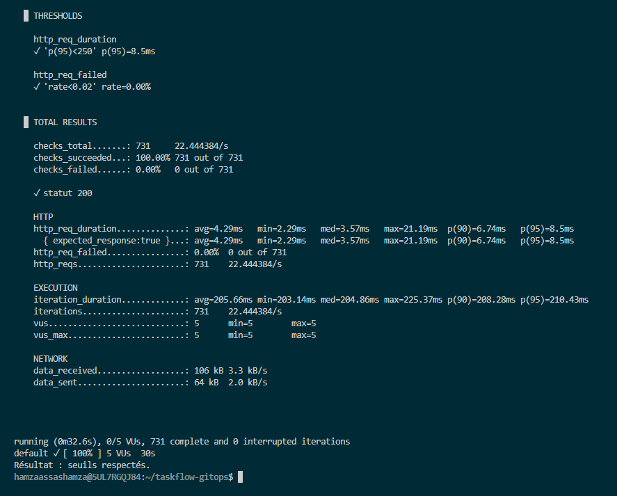

Un point à garder en tête : les trois essais donnent un p95 entre 8,5 et 13,2 ms. Cette variation vient de la machine locale, pas de l'application, ce qui explique que le seuil de 250 ms laisse une grande marge.

### Partie A, étapes 3 et 4 : brancher l'analyse automatique

**L'idée, en simple.** Jusqu'ici, pendant un canary, c'est nous qui regardions les résultats et qui décidions d'avancer ou de tout arrêter. Maintenant, on confie cette décision au test de charge : à chaque nouvelle version, le déploiement lance tout seul le test k6 sur la nouvelle version, et selon le résultat, il continue ou il abandonne.

**Ce qu'on a ajouté** (PR #25, `feat/analyse-auto`, approuvée par Ezzat et mergée vers 09:03 UTC) : 4 fichiers dans `apps/taskflow/`.

| Fichier | À quoi il sert |
| --- | --- |
| `analysis-template.yaml` | La recette de l'analyse : lancer un petit programme k6 (un « Job »). S'il réussit, on continue, s'il échoue, on abandonne. |
| `configmap-k6.yaml` | Le scénario du test et ses seuils : moins de 2 % d'erreurs, p95 sous 250 ms. |
| `service-canary.yaml` | Une adresse interne, `taskflow-canary`, qui ne mène **qu'aux pods de la nouvelle version**. |
| `rollout.yaml` (modifié) | Le déploiement lui-même : après le palier de 25 %, il attend 20 secondes, lance l'analyse, puis continue (50 %, 75 %, 100 %) ou s'arrête. L'image reste en 2.0.0. |

**Pourquoi un service `taskflow-canary` à part ?** Si on testait via le service normal, 75 % des requêtes tomberaient encore sur l'ancienne version, qui marche, et un défaut de la nouvelle version serait dilué dans la masse. Avec `taskflow-canary`, le test ne voit **que** la nouvelle version : on mesure vraiment ce qu'on s'apprête à livrer.

**Ce qu'on a vérifié après le merge.** Argo CD a tout appliqué tout seul. On y retrouve :

- le `ConfigMap` `k6-robustesse` et le service `taskflow-canary`, créés quelques secondes plus tôt,
- l'`AnalysisTemplate` `robustesse-k6` (apparu un peu après les autres, c'est la raison pour laquelle la première commande ne le montrait pas encore),
- l'application `Synced` / `Healthy`,
- le Rollout `Healthy`, toujours en 2.0.0 : rien n'a été redéployé, on a seulement changé la façon de déployer. Il est passé de 6 à **7 étapes**, ce qui montre qu'il a bien pris en compte la pause et l'analyse.

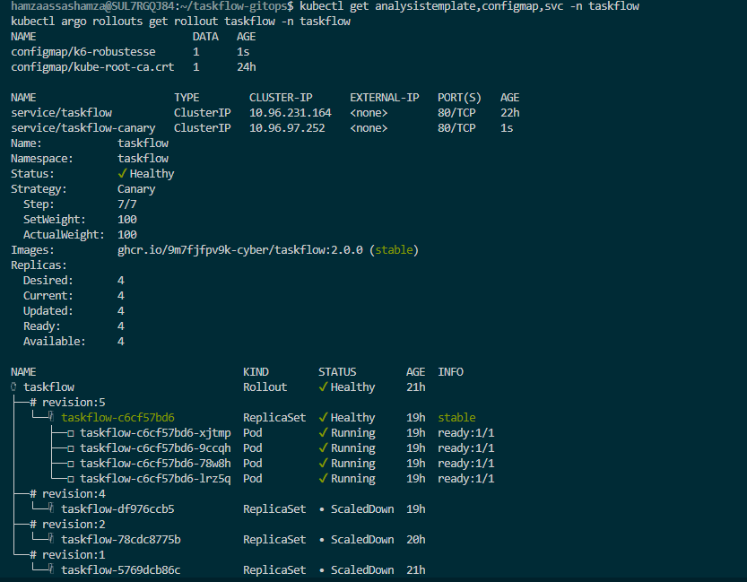

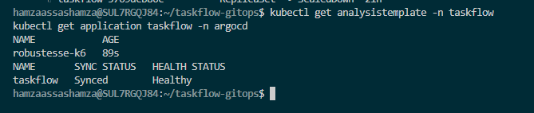

### Partie B, étapes 1 et 2 : l'incident de la 2.1.0 et l'enquête

**Ce qu'on a fait.** On a poussé la version 2.1.0, celle qui est défectueuse, par une PR normale (PR #26, approuvée par Ezzat et mergée vers 09:14 UTC), puis on n'a **plus rien touché**. Le but était de voir si la chaîne se défendait seule.

**Ce qui s'est passé, dans l'ordre** (heures UTC, arrondies) :

| Heure | Ce qui s'est passé |
| --- | --- |
| ~09:14 | Merge de la PR #26 : l'image passe de 2.0.0 à 2.1.0 |
| ~09:16 | Argo CD déploie (environ 2 minutes après le merge) |
| ~09:16 | Le canary démarre : **1 pod sur 4** en 2.1.0 (25 %), puis une pause de 20 secondes |
| ~09:16 | Le Rollout lance l'analyse : un petit programme k6 teste le service `taskflow-canary`, qui ne mène qu'au pod en 2.1.0 |
| ~09:17 | k6 trouve que la version est mauvaise, l'analyse échoue, et le Rollout **annule tout seul** : le pod 2.1.0 est supprimé et les 4 pods en 2.0.0 reprennent tout le trafic |

Entre le moment où la 2.1.0 a reçu du trafic et celui où elle a été retirée, il s'est écoulé environ **une minute**, et un seul pod sur quatre était concerné. Personne n'a eu à appuyer sur un bouton.

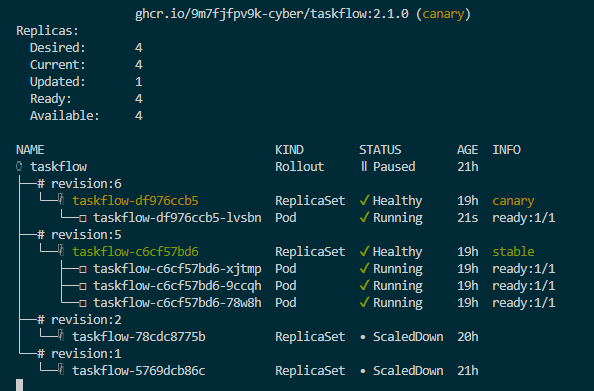

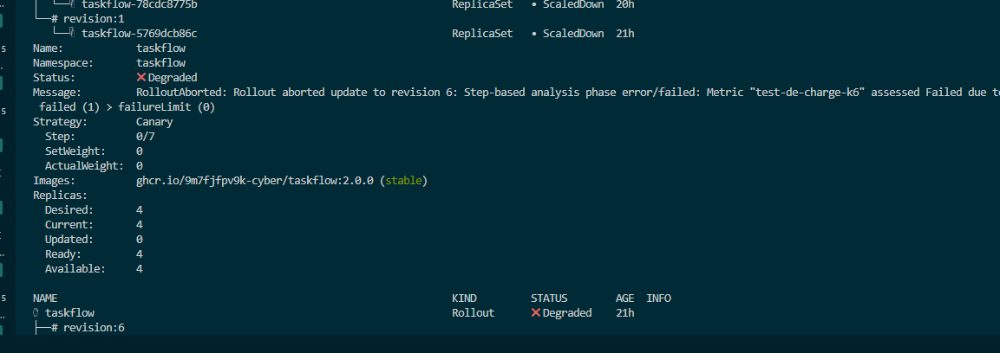

La vue d'ensemble après l'abort, en capture : la révision 6 (2.1.0) est à 0 pod, son `AnalysisRun` est `Failed` (1 échec) avec le Job k6 `Failed`, et la révision 5 (2.0.0) a repris ses 4 pods.

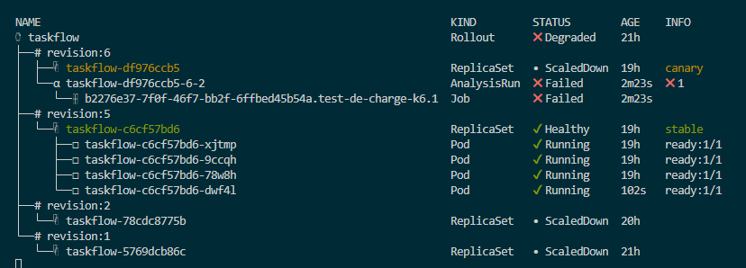

La même vue en texte, relevée sur le cluster juste après (commande `kubectl argo rollouts get rollout taskflow -n taskflow`, extrait). La révision 6 (2.1.0) est à 0 pod, son `AnalysisRun` est en échec avec le Job k6 qui a échoué, et la révision 5 (2.0.0) a repris ses 4 pods :

```
Status:          ✖ Degraded
Message:         RolloutAborted: Rollout aborted update to revision 6: ... Metric "test-de-charge-k6" assessed Failed due to failed (1) > failureLimit (0)
Images:          ghcr.io/9m7fjfpv9k-cyber/taskflow:2.0.0 (stable)

├──# revision:6
│  ├──⧉ taskflow-df976ccb5      ReplicaSet   • ScaledDown   canary
│  └──α taskflow-df976ccb5-6-2  AnalysisRun  ✖ Failed       ✖ 1
│     └──⊞ ...test-de-charge-k6.1  Job       ✖ Failed
├──# revision:5
│  └──⧉ taskflow-c6cf57bd6      ReplicaSet   ✔ Healthy      stable
│     ├──□ taskflow-c6cf57bd6-xjtmp  Pod     ✔ Running
│     ├──□ taskflow-c6cf57bd6-9ccqh  Pod     ✔ Running
│     ├──□ taskflow-c6cf57bd6-78w8h  Pod     ✔ Running
│     └──□ taskflow-c6cf57bd6-dwf4l  Pod     ✔ Running
```

### L'enquête : les preuves

Pour comprendre ce qui a échoué, on a suivi la chaîne de preuves du cours, du général au précis.

**Preuve 1, quelle révision et quelle image ?** Le Rollout est `Degraded` avec le message `RolloutAborted: Rollout aborted update to revision 6`. La révision 6 est la 2.1.0 (ReplicaSet `taskflow-df976ccb5`). La production reste en 2.0.0, révision 5, `stable`.

**Preuve 2, quelle analyse a échoué ?** Il y a une seule analyse, `taskflow-df976ccb5-6-2`, en état `Failed`. Elle porte sur une seule métrique, `test-de-charge-k6`, avec le message :

```
Metric "test-de-charge-k6" assessed Failed due to failed (1) > failureLimit (0)
```

Autrement dit : on ne tolérait aucun échec du test, il y en a eu un, donc c'est refusé.

**Preuve 3, qu'est-ce que k6 a mesuré ?** C'est là qu'on voit pourquoi. Extrait des logs du Job k6, qui a visé le pod en 2.1.0 seulement :

```
http_req_duration  ✗ 'p(95)<250'  p(95)=311.52ms
http_req_failed    ✗ 'rate<0.02'  rate=33.00%
http_reqs: 300     (dont 99 en erreur)
```

Les **deux seuils** sont dépassés :

- **33 % des requêtes échouent**, alors que la limite est de 2 %. Un tiers des utilisateurs qui tomberaient sur cette version verrait une erreur.
- **Le p95 est de 311 ms**, alors que la limite est de 250 ms, et que la 2.0.0 répondait en 8 à 13 ms (notre étalon). La version est donc environ **30 fois plus lente**. Même les réponses correctes mettent en moyenne 305 ms.

**Preuve 4, la chronologie.** Les événements Kubernetes confirment l'ordre (`RolloutUpdated`, `RolloutPaused`, `AnalysisRunRunning`, puis `MetricFailed`, `AnalysisRunFailed` et `RolloutAborted`, tous au même moment, suivis de la remise à 4 pods de la 2.0.0). On a relevé ces événements tout de suite, car Kubernetes ne les garde qu'environ une heure.

### D'où vient l'erreur, et pourquoi les probes étaient vertes ?

**Un défaut simulé, pas un vrai bug.** Dans le code de TaskFlow, il y a un petit morceau appelé `inject_faults`, dont le commentaire dit : « Simule une version défaillante : /health reste sain, les utilisateurs souffrent ». Il a été prévu par le cours pour fabriquer exprès une mauvaise version. On l'a trouvé en lisant le code de l'image (`/app/app/main.py`). Il lit deux réglages :

- `LATENCY_MS` : combien de millisecondes attendre avant de répondre ;
- `FAILURE_RATE` : la chance, entre 0 et 1, de répondre une erreur 500 (« Erreur interne ») au lieu de la vraie réponse.

Ces réglages sont fixés dans chaque image. On peut les lire avec `docker image inspect` :

| Version | `FAILURE_RATE` | `LATENCY_MS` | Comportement |
| --- | --- | --- | --- |
| 2.0.0 | 0 | 0 | normal |
| **2.1.0** | **0,3** | **300** | **30 % d'erreurs et 0,3 s de retard sur chaque requête** |
| 2.2.0 | 0 | 0 | normal (corrigée) |

**Ça colle avec ce que k6 a mesuré.** Avec 30 % d'erreurs réglées, k6 a vu 33 % (99 sur 300) : l'écart vient du hasard. Avec 300 ms de retard, les réponses prenaient en moyenne 305 ms et le p95 était à 311 ms, alors que la 2.0.0 répond en 4 à 6 ms en moyenne. Tout vient bien de ces deux réglages.

**Pourquoi les probes étaient vertes.** Le code applique le retard et les erreurs à toutes les routes **sauf** `/health` (la ligne `if request.url.path != "/health"`). Or les sondes de Kubernetes ne regardent que `/health`. Elles recevaient donc toujours une réponse rapide et correcte : le pod était déclaré sain pendant que tout le reste était lent et plantait une fois sur trois. Une sonde dit « le programme tourne », pas « le programme rend le service attendu ». Seul un test qui envoie du vrai trafic sur les vraies routes, comme k6, pouvait le voir.

**Dans la vraie vie.** Ici le défaut est volontaire. Mais le mécanisme est réaliste : une vraie régression (requête de base de données lente, dépendance qui tombe, bug sur une route) laisserait aussi `/health` vert. C'est pour ça qu'un déploiement progressif avec une analyse sur de vraies requêtes protège mieux qu'une simple sonde.

### Comment on aurait pu l'empêcher

Il y a trois façons de se protéger d'une mauvaise version : **l'empêcher** d'arriver au cluster, **la repérer vite** quand elle arrive, et **limiter les dégâts** si elle passe. Notre chaîne faisait déjà les deux dernières. Voici ce qui manquait pour la première, et ce qu'on peut encore améliorer.

**1. Tester la version avant même de la publier (empêcher).** Le défaut était dans l'image elle-même. Un test de charge lancé dans la chaîne de construction de l'application, avant de publier l'image, aurait vu les 33 % d'erreurs et les 300 ms de retard et refusé de créer la 2.1.0. Au moment du déploiement, il est déjà tard : on a seulement un `git revert` à faire. C'est le plus efficace, parce que la mauvaise version n'arrive jamais jusqu'aux utilisateurs.

**2. Des sondes qui regardent une vraie route (repérer).** Nos sondes ne visaient que `/health`, que le code exclut du défaut. Si elles avaient appelé une vraie route (par exemple `/tasks`), le pod 2.1.0 n'aurait jamais été déclaré prêt, et Kubernetes ne l'aurait pas mis en service. On repère alors le problème dès le démarrage du pod, sans même attendre l'analyse de charge.

**3. Un test automatique à chaque palier, pas seulement au premier (limiter).** L'analyse se fait aujourd'hui une seule fois, à 25 %. Si un défaut n'apparaissait qu'à plus forte charge, il passerait ce palier. Refaire l'analyse à 50 % et 75 % réduit ce risque.

**4. Regarder ce que contient l'image, pas seulement son numéro (empêcher).** Notre PR ne changeait qu'un numéro de version, donc la personne qui relisait ne pouvait pas voir les réglages de panne placés dans l'image. Exiger un contrôle automatique sur l'image (tests de charge ou analyse de sa configuration) dans la chaîne, avant d'autoriser une PR qui la référence, comble ce trou.

**5. Garder un seuil strict (limiter).** Notre analyse acceptait zéro échec (`failureLimit: 0`) et des seuils précis. C'est ce qui a permis un abort en environ une minute. Des seuils plus souples auraient pu laisser passer la 2.1.0.

**Ce qui a déjà bien joué.** Le canary a limité l'exposition à un pod sur quatre, l'analyse sur `taskflow-canary` a mesuré la nouvelle version seule, et l'abort s'est fait sans intervention. Le déploiement progressif ne remplace pas les tests en amont : il sert de dernier filet quand quelque chose a échappé aux tests.

### Ce qu'il reste à faire après l'abort

L'abort a protégé les utilisateurs, mais il n'a pas changé Git : `rollout.yaml` dit toujours **2.1.0**. Il faut donc remettre la vérité dans Git par une PR de revert, puis livrer la version corrigée 2.2.0 (étapes suivantes du lab).

### Partie B, étape 3 : remettre Git d'accord par un revert

Après l'abort, la production était sauve, mais **Git disait toujours 2.1.0**. L'abort est une action du cluster : il n'a rien changé dans le dépôt. On a donc fait un revert de la PR #26 par une nouvelle PR (PR #27, approuvée par Ezzat, mergée vers 09:26 UTC). Argo CD l'a appliquée quelques secondes plus tard : le Rollout est repassé `Healthy` en 2.0.0, Argo CD `Synced` / `Healthy`. Git, le cluster et les utilisateurs disaient de nouveau la même chose.

Entre l'abort (vers 09:17) et le revert (vers 09:26), Git est resté en désaccord avec la réalité pendant environ **neuf minutes**. Ce n'était pas dangereux, car plus personne n'était exposé, mais c'est un écart à ne pas laisser traîner.

La trace de l'échec est restée visible dans l'historique du Rollout : la révision 6 garde son `AnalysisRun` en `Failed`.

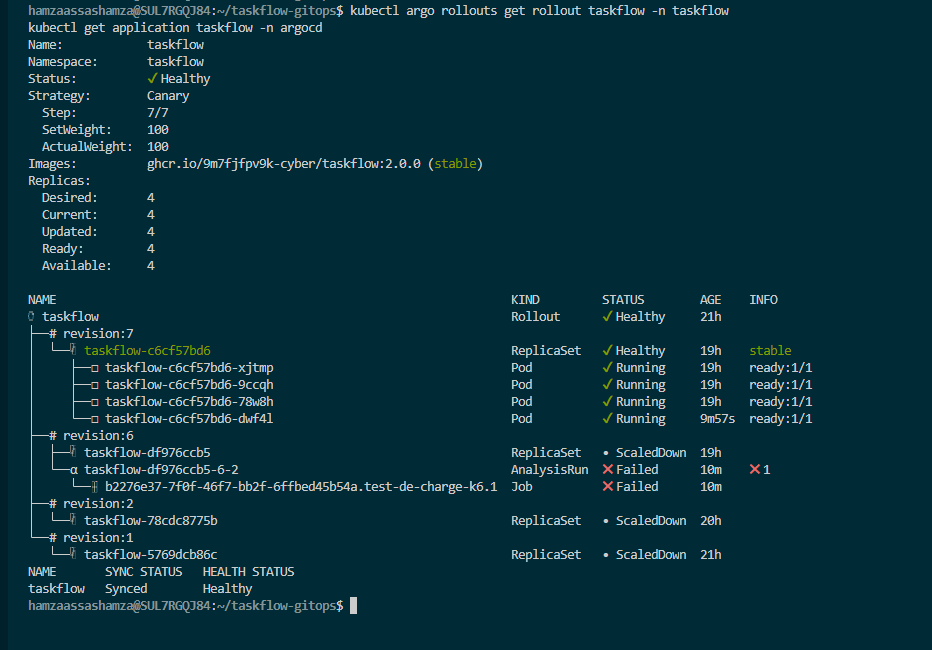

### Partie B, étape 4 : la 2.2.0, la version corrigée

On a livré la version corrigée 2.2.0 par une PR normale (déployée par Argo CD vers 09:34 UTC), et on a de nouveau **laissé faire**. Cette fois le Rollout est monté à 25 %, a attendu 20 secondes, a lancé l'analyse k6, qui a **réussi**, puis il a continué tout seul : 50 %, 75 %, 100 %, jusqu'à `Healthy` avec la 2.2.0 en `stable`. Aucune commande de notre part entre le merge et la fin.

La capture ci-dessous réunit les deux analyses sur le même écran : celle de la 2.2.0 (`Successful`, révision 8) et celle de la 2.1.0 qui avait échoué (`Failed`, révision 6).

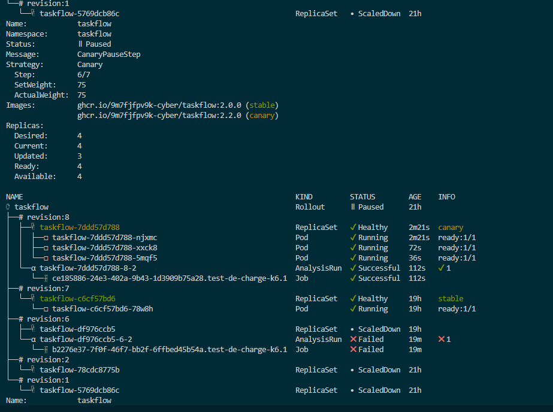

À la fin, le Rollout est `Healthy` à 100 % : la 2.2.0 est `stable` sur 4 pods, l'ancienne 2.0.0 est `ScaledDown`, et on retrouve côte à côte l'analyse réussie de la 2.2.0 et celle qui avait échoué pour la 2.1.0.

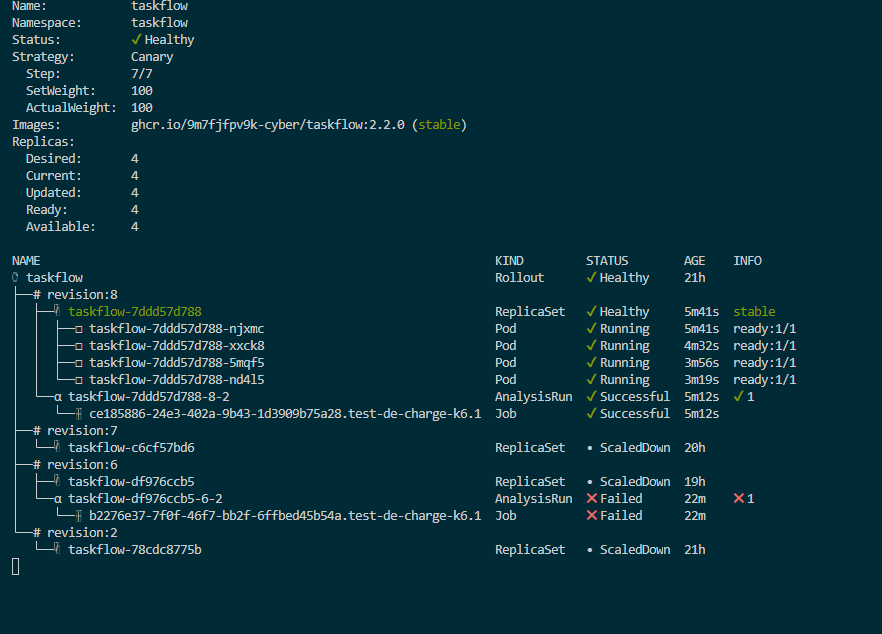

**Ce que k6 a mesuré**, version par version, sur les mêmes seuils (moins de 2 % d'erreurs, p95 sous 250 ms) :

| Version | Requêtes | Erreurs | p95 | Résultat de l'analyse |
| --- | --- | --- | --- | --- |
| 2.0.0 (étalon, test à la main) | environ 730 | 0,00 % | 8,5 à 13,2 ms | seuils respectés |
| **2.1.0** (analyse automatique) | 300 | **33,00 %** | **311,5 ms** | **échec, abort automatique** |
| **2.2.0** (analyse automatique) | 736 | 0,00 % | 6,6 ms | **réussite, promotion automatique** |

La 2.1.0 a franchi les deux seuils à la fois (erreurs et lenteur), conformément à ses réglages. La 2.2.0 est revenue aux réglages normaux et passe sans problème.

### Postmortem

Le postmortem de l'incident de la 2.1.0 est dans [docs/postmortem-2.1.0.md](docs/postmortem-2.1.0.md).

## Jour 3, lab de l'après-midi : la sécurité devient un contrôle automatique (15/10/2026)

### L'idée, en simple

Dans `policies/pssi.md`, l'équipe a écrit cinq règles de sécurité en français (la mini-PSSI de TaskFlow). Mais une règle écrite dans un document, personne n'est obligé de la respecter. Le but de ce lab est de **transformer ces règles en contrôles automatiques** : à chaque Pull Request, un robot vérifie les fichiers, et si une règle est violée, **la PR ne peut plus être mergée**. C'est ce qu'on appelle le « Policy as Code » : la politique de sécurité est écrite sous forme de code, et appliquée par la chaîne elle-même.

On utilise deux outils :

- **conftest** lit nos fichiers YAML (`apps/`) et les compare aux règles écrites en Rego (`policies/kubernetes.rego`). Il est rapide et sert pour les règles R1 à R4.
- **Trivy** scanne les images à la recherche de failles de sécurité connues. Il sert pour la règle R5.

Le travail de cette partie a été fait surtout par Ezzat (règles, correctif, workflow, exceptions) et relu et mergé par Hamza.

### Étape 1 : lire les règles et lancer conftest

Au départ, `policies/kubernetes.rego` contenait déjà les règles R1 (tag explicite, pas de `latest`) et R2 (images uniquement du registre autorisé). Les règles R3 et R4 étaient à écrire. On a lancé conftest pour voir l'état de départ :

```
conftest test apps/ --policy policies/
15 tests, 15 passed, 0 failures
```

Les 15 tests viennent de 3 vérifications (R1 compte pour deux : « pas de tag » et « tag latest », plus R2) appliquées à chacun des 5 fichiers de `apps/taskflow/`. Tout passe, puisque nos images ont un tag précis et viennent bien de notre registre.

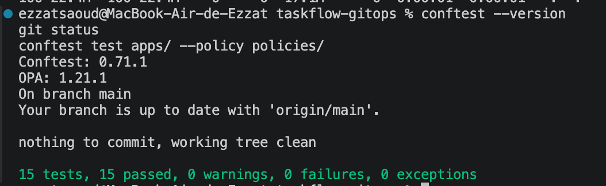

### Étape 2 : écrire R3 et R4

On a ajouté les deux règles manquantes dans `policies/kubernetes.rego`.

- **R3, limite de mémoire.** Chaque conteneur doit déclarer une limite de mémoire. Pourquoi : un conteneur qui consomme toute la mémoire pourrait faire tomber la machine entière et les autres applications avec lui.
- **R4, pas de root.** Le pod doit déclarer explicitement `runAsNonRoot: true`. Pourquoi : si quelqu'un parvient à prendre le contrôle du conteneur, il ne doit pas y être administrateur, pour limiter les dégâts.

Avec R3 ajoutée, conftest passe à **20 tests, tous réussis** (4 vérifications sur 5 fichiers) : nos conteneurs avaient déjà une limite de mémoire.

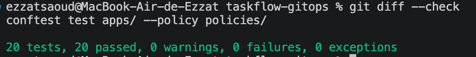

### Étape 3 : rendre le Rollout conforme à R4

Notre Rollout ne disait nulle part « interdit de tourner en root ». R4 aurait donc refusé ce fichier : c'est exactement ce qu'elle est faite pour détecter. On l'a corrigé en ajoutant ces deux lignes dans `apps/taskflow/rollout.yaml`, sous `spec.template.spec` :

```yaml
securityContext:
  runAsNonRoot: true
```

Ce changement est sans risque pour l'application : on a vérifié que l'image de TaskFlow tourne déjà avec un utilisateur normal (l'utilisateur numéro 10001, pas root). Les pods démarrent donc comme avant.

Avec R4 et le correctif, conftest passe à **25 tests, tous réussis** (5 vérifications sur 5 fichiers).

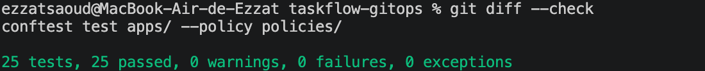

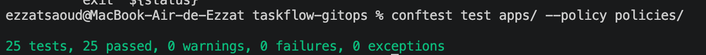

### Étape 4 : brancher les contrôles dans GitHub (PR #30)

Lancer conftest à la main ne suffit pas : on peut l'oublier. On a donc copié le modèle `exemples/ci/pssi-github.yml` dans `.github/workflows/pssi.yml`. À chaque PR, GitHub lance maintenant deux contrôles tout seul :

- **PSSI manifests (conftest)** : vérifie les règles R1 à R4 ;
- **PSSI images (Trivy)** : cherche les failles connues dans les images (règle R5).

Tout cela est arrivé par la **PR #30**, `feat: enforce PSSI manifest and image quality gates`, mergée vers 12:03 UTC. Elle contient quatre commits : les règles R3/R4, le correctif non-root, le workflow, et les exceptions Trivy.

**Le premier passage a échoué, et c'est instructif.** Le contrôle conftest était vert, mais le contrôle Trivy a échoué. Il a trouvé **9 failles de gravité HIGH** dans l'image de TaskFlow 2.2.0, toutes dans des bibliothèques Python. Par exemple, la bibliothèque `starlette` est installée en version 0.41.3, alors que la faille CVE-2025-62727 (un risque de déni de service) est corrigée dans la version 0.49.1. La règle R5 interdit les failles graves **qui ont déjà un correctif**, et ici il y en avait.

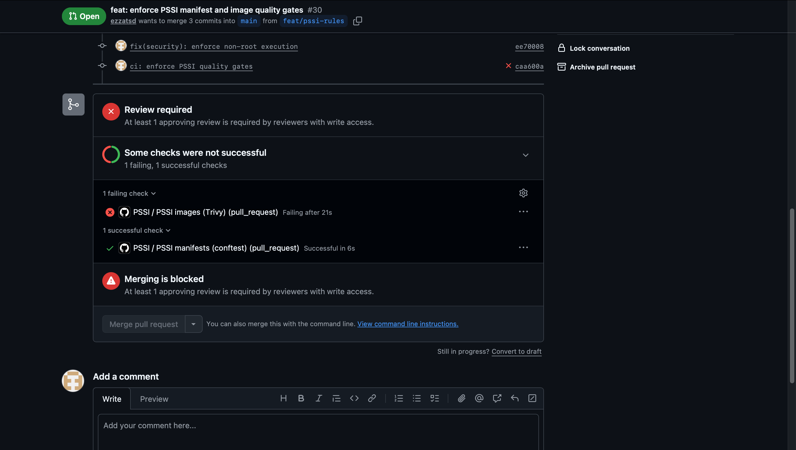

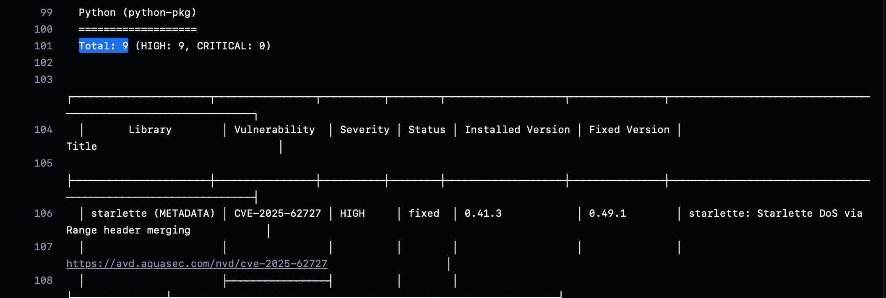

**Pourquoi on n'a pas simplement corrigé.** L'image de TaskFlow est fournie par un dépôt externe (celui du cours) : on ne peut pas la reconstruire depuis notre dépôt GitOps pour mettre à jour les bibliothèques. La règle de la PSSI prévoit ce cas : on peut faire une **exception, à condition qu'elle soit écrite, justifiée, datée et limitée dans le temps, et validée en PR**. On a donc créé un fichier `.trivyignore` qui liste les 9 failles concernées, avec en commentaire :

- l'image concernée (TaskFlow 2.2.0),
- la justification (image externe, impossible à reconstruire ici),
- les responsables (Hamza et Ezzat),
- la date de création (15/10/2026) et la **date d'expiration (22/10/2026)**,
- le suivi à faire : reconstruire une image corrigée, puis supprimer toutes ces exceptions.

Avec cette exception, le contrôle Trivy est passé au vert : les deux contrôles réussissent.

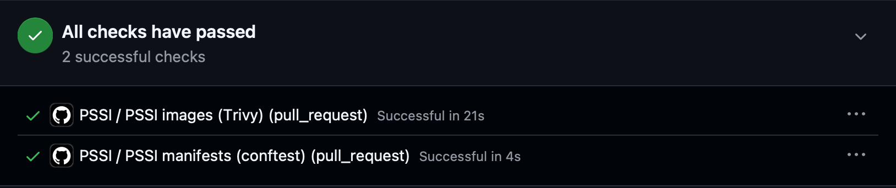

À noter : cette exception n'est pas une façon de contourner la règle. Elle reconnaît une faille connue, dit pourquoi on l'accepte, qui en répond, et jusqu'à quand. Passé le 22/10/2026, elle doit disparaître.

### Étape 5 : rendre les contrôles obligatoires

Un contrôle qu'on peut ignorer n'est qu'un conseil. On a donc modifié le ruleset de la branche `main` : l'option **« Require status checks to pass »** est activée, avec les deux contrôles **PSSI manifests (conftest)** et **PSSI images (Trivy)** en obligatoires. On a aussi gardé **« Require branches to be up to date before merging »** : une PR doit être testée avec la dernière version de `main` avant d'être mergée. Désormais, le bouton de merge reste bloqué tant que ces deux contrôles ne sont pas verts.


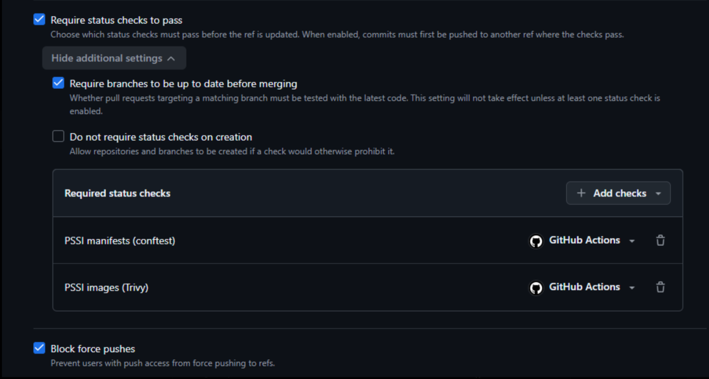

### Étape 6 : prouver que ça bloque vraiment

Pour vérifier que les règles ne sont pas décoratives, on a volontairement ouvert une PR **non conforme** : sur la branche `test/pssi-nonconforme`, on remplace l'image de TaskFlow par `nginx:latest`. Cette image enfreint deux règles à la fois :

- **R1** : elle utilise le tag `latest`, qui ne dit pas quelle version tourne réellement ;
- **R2** : elle ne vient pas de notre registre autorisé.

En local, conftest refuse ce fichier avec deux échecs, un par règle :

```
FAIL - apps/taskflow/rollout.yaml - PSSI-R1 : le conteneur 'taskflow' utilise le tag latest (nginx:latest)
FAIL - apps/taskflow/rollout.yaml - PSSI-R2 : l'image du conteneur 'taskflow' ne vient pas du registre autorisé (nginx:latest)
25 tests, 23 passed, 0 warnings, 2 failures, 0 exceptions
```

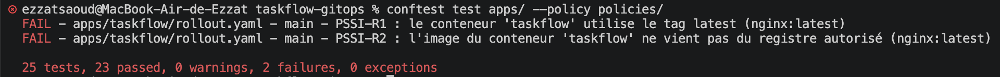

Sur GitHub, la même chose se produit dans la PR : le contrôle **PSSI manifests (conftest)** passe au rouge, marqué **Required** (obligatoire), et le bouton **Merge pull request** reste grisé. Cette PR est là pour servir de preuve : elle n'est pas faite pour être mergée.

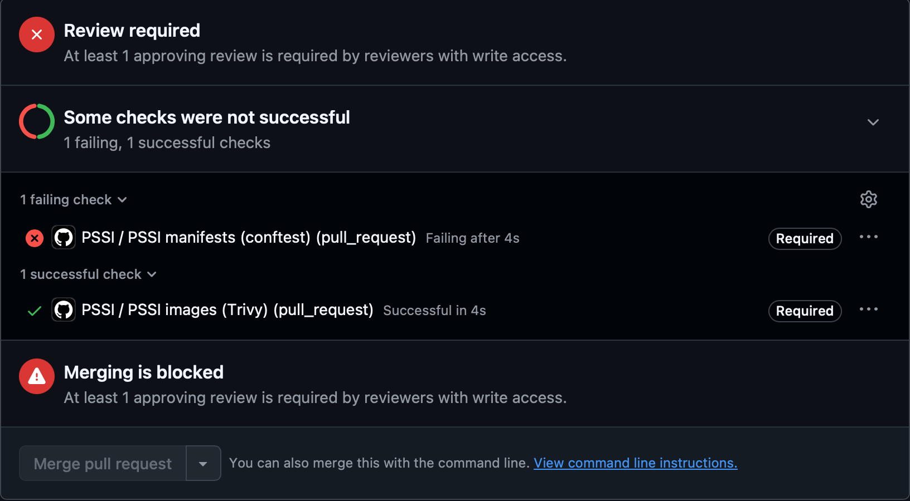

### Le tableau règle, contrôle, outil, preuve

| Règle | Ce qu'elle exige | Contrôle automatique | Outil | Preuve |
| --- | --- | --- | --- | --- |
| **R1** | Tag explicite, jamais `latest` | Deux règles dans `policies/kubernetes.rego` (pas de tag, tag `latest`) | conftest | `nginx:latest` refusé : échec R1 ([capture](docs/preuve/47-pssi-conftest-nginx-latest.png)), PR bloquée ([capture](docs/preuve/48-pssi-pr-non-conforme-bloquee.png)) |
| **R2** | Images uniquement du registre `ghcr.io/9m7fjfpv9k-cyber/` | Une règle dans `policies/kubernetes.rego` | conftest | `nginx:latest` refusé : échec R2 ([capture](docs/preuve/47-pssi-conftest-nginx-latest.png)) |
| **R3** | Limite de mémoire sur chaque conteneur | Règle R3 écrite (étape 2) | conftest | 20 tests réussis une fois R3 ajoutée ([capture](docs/preuve/39-pssi-r3-20-tests.png)) |
| **R4** | Pods jamais en root (`runAsNonRoot: true`) | Règle R4 écrite (étape 2) + `securityContext` ajouté au Rollout (étape 3) | conftest | 25 tests réussis ([capture](docs/preuve/40-pssi-r4-25-tests.png)) |
| **R5** | Aucune faille HIGH ou CRITICAL qui a un correctif | Job `PSSI images (Trivy)` dans `.github/workflows/pssi.yml` | Trivy | 9 failles HIGH trouvées ([capture](docs/preuve/43-pssi-trivy-9-high.png)), puis exceptions datées dans `.trivyignore` et contrôle vert ([capture](docs/preuve/44-pssi-checks-verts.png)) |
| **Obligatoire** | Un contrôle rouge bloque le merge | Ruleset de `main` : « Require status checks to pass » | GitHub | Contrôles obligatoires ([capture](docs/preuve/45-pssi-ruleset-checks-obligatoires.png)), merge grisé ([capture](docs/preuve/48-pssi-pr-non-conforme-bloquee.png)) |

### Ce qu'on retient

Une règle de sécurité n'existe vraiment que si une machine la vérifie à chaque changement, et une exception n'est acceptable que si elle est écrite, justifiée, attribuée à quelqu'un et datée. Ici, la chaîne a refusé tout ce qui enfreignait la PSSI, y compris une faille réelle trouvée par Trivy dans notre propre image, et on a pu l'accepter temporairement de façon contrôlée.

